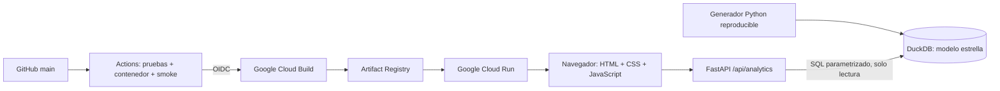

# Andes Analytics · DuckDB OLAP

Aplicación full stack para explorar ventas minoristas sintéticas en Perú. Permite analizar ingresos, utilidad bruta, margen, pedidos, unidades y ticket promedio mediante filtros, agregaciones temporales y subtotales SQL.

- **Repositorio público:** https://github.com/Abel-GG-777/olap-analytics-duckdb
- **Aplicación pública:** pendiente de habilitar el proyecto Google Cloud y ejecutar el primer despliegue. No hay una URL de producción verificada todavía.
- **Destino de despliegue:** Google Cloud Run, Cloud Build y Artifact Registry. La arquitectura no utiliza AWS.
- **Artículo listo para Dev.to:** [docs/devto.md](docs/devto.md).
- **Estado de verificación:** [docs/verification.md](docs/verification.md).

## Caso de uso

¿Qué ciudades generan más ingresos? ¿Qué categoría aporta margen? ¿Cómo varían las ventas mensuales? Elegí ventas minoristas porque sus medidas son comprensibles y sus dimensiones permiten demostrar operaciones OLAP prácticas sin usar datos personales.

Los datos son **generados**, no proceden de una empresa ni de estadísticas oficiales. El generador [app/warehouse.py](app/warehouse.py) usa `random.Random(42)` y el identificador `retail-v1-seed42`: 60 000 pedidos entre 2024-01-01 y 2025-12-31, cuatro ciudades, cuatro categorías, dos canales y moneda PEN. Cada pedido contiene una única categoría; no se modelan líneas de pedido, devoluciones, impuestos, descuentos ni tipos de cambio. Las fechas y dimensiones se muestrean sin una estacionalidad comercial deliberada; las tendencias no permiten inferir comportamiento real del mercado peruano.

## Arquitectura



Tecnologías: Python 3.12, DuckDB 2.0.0, FastAPI, Uvicorn, JavaScript sin framework, CSS adaptable, pytest, Ruff, Docker y GitHub Actions. La UI y la API se sirven desde el mismo origen, sin servicios externos para gráficos o fuentes.

Modelo estrella: `fact_sales` tiene grano de **un pedido**; `dim_city`, `dim_category` y `dim_date` aportan dimensiones. `channel` es una dimensión degenerada en la tabla de hechos. La vista `sales` resuelve las uniones. Claves primarias y foráneas protegen la integridad. Importes almacenados como `DECIMAL(14,2)`; el JSON los transforma a números para visualización.

La imagen Docker genera la base antes de desplegar. Cada instancia abre conexiones de solo lectura por solicitud. Un proceso Uvicorn por contenedor evita escritores concurrentes durante el arranque local. No se escribe información de usuarios ni se requiere volumen persistente. Una actualización del generador produce otra instantánea al reconstruir la imagen.

## Ejecutar localmente

Requiere Python 3.12. En PowerShell, desde la raíz:

```powershell
py -3.12 -m venv .venv
.\.venv\Scripts\python.exe -m pip install -r requirements-dev.txt
.\.venv\Scripts\python.exe -m app.warehouse
.\.venv\Scripts\python.exe -m uvicorn app.main:app --host 127.0.0.1 --port 8080
```

En Linux/macOS:

```bash
python3.12 -m venv .venv
source .venv/bin/activate
pip install -r requirements-dev.txt
python -m app.warehouse
uvicorn app.main:app --host 127.0.0.1 --port 8080
```

Abre http://localhost:8080. Documentación interactiva: http://localhost:8080/docs. Salud: http://localhost:8080/health.

La primera generación puede tardar unos minutos según el equipo. Si omites la generación, el servidor la ejecuta al iniciar. No inicies ambos procesos simultáneamente. El generador rechaza sobrescribir archivos existentes; para experimentar usa `python -m app.warehouse --path data/otra.duckdb` y configura `DUCKDB_PATH` antes de arrancar. Reinicia el servidor tras cambiar la base.

Con Docker:

```bash
docker build -t olap-analytics-duckdb .
docker run --rm -p 8080:8080 olap-analytics-duckdb
```

## Indicadores y operaciones OLAP

| Indicador | Definición |
|---|---|
| Ingresos | `sum(revenue)` |
| Utilidad bruta | `sum(revenue-cost)` |
| Margen bruto | `100 * sum(revenue-cost) / sum(revenue)` |
| Pedidos | `count(*)` |
| Unidades | `sum(units)` |
| Ticket promedio | `sum(revenue) / count(*)` |

El margen se calcula sobre los totales; no se promedian porcentajes por pedido. Una selección vacía devuelve ceros y un mensaje explícito. Las fechas son inclusivas. La serie omite períodos sin ventas; `change` compara con el período anterior presente en la selección, y el primero devuelve `null`. No es una comparación contra todo el negocio ni contra períodos fuera del filtro.

- **Slice/dice:** ciudad, categoría, canal y rango de fechas combinables.
- **Drill down/roll up temporal:** cambiar entre año, trimestre y mes.
- **Rollup jerárquico:** detalle ciudad/categoría, subtotal por ciudad y total general.
- **Ventana analítica:** `lag(revenue)` para variación absoluta entre períodos presentes.

Ejemplos ejecutables: [sql/examples.sql](sql/examples.sql). API:

```text
/api/analytics?start=2025-01-01&end=2025-12-31&city=Lima&channel=Web&dimension=category&grain=month
```

Los valores se envían como parámetros SQL. `dimension` y `grain` usan listas permitidas; la API no permite SQL arbitrario. `limit` admite 1–20 y solo limita la distribución por dimensión, no los KPI ni el total general.

## Pruebas

```powershell
.\.venv\Scripts\python.exe -m pytest -q
.\.venv\Scripts\python.exe -m ruff check app tests scripts
node --check app/static/app.js
# Con el servidor ya levantado y la base completa:
.\.venv\Scripts\python.exe scripts/smoke.py http://localhost:8080
```

En Linux usa `python`/`ruff` desde el entorno activado. Node se usa solo para comprobar la sintaxis JavaScript. Las pruebas cubren cálculos con fixture conocido, conciliación de agregados, filtros, granularidad, selección vacía, entradas inválidas, reproducibilidad y lecturas concurrentes. No requieren red.

## CI/CD y despliegue

[El workflow](.github/workflows/ci-deploy.yml) verifica cada PR y cada cambio en `main`: Ruff, pytest, sintaxis JavaScript, construcción Docker y smoke HTTP del contenedor. El job de despliegue depende de esas verificaciones. Si falta `GCP_PROJECT_ID`, se omite el despliegue explícitamente; una CI verde por sí sola **no** prueba que exista una aplicación pública.

El despliegue autentica GitHub en Google Cloud mediante OIDC, construye desde el Dockerfile y publica en Cloud Run. Después consulta la URL real y ejecuta el mismo smoke test. Las instrucciones de preparación, permisos, variables y recuperación están en [docs/deployment.md](docs/deployment.md).

## Límites y siguientes mejoras

Es un laboratorio OLAP de lectura, no un sistema transaccional. Las 60 000 filas ilustran funcionalidades; no constituyen un benchmark ni justifican promesas de escalabilidad. Faltan evaluación de carga, pruebas visuales automatizadas, autenticación para datos privados e ingesta incremental. Para datos reales ampliaría las validaciones del pipeline, versionaría instantáneas y mediría latencia/costo con cargas representativas. Licencia MIT para código y documentación; datos sintéticos generados por el mismo código.
