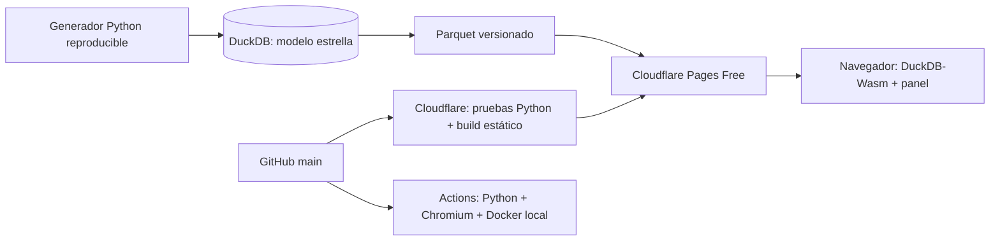

# Andes Analytics · DuckDB OLAP

Aplicación full stack para explorar ventas minoristas sintéticas en Perú. Permite analizar ingresos, utilidad bruta, margen, pedidos, unidades y ticket promedio mediante filtros, agregaciones temporales y subtotales SQL.

- **Repositorio público:** https://github.com/Abel-GG-777/olap-analytics-duckdb
- **Aplicación pública:** https://olap-analytics-duckdb.pages.dev — alojada en Cloudflare Pages.
- **Destino gratuito:** Cloudflare Pages Free, con DuckDB-Wasm ejecutando SQL en el navegador. No requiere tarjeta, proyecto GCP, servidor de pago ni AWS.
- **Artículo listo para Dev.to:** [docs/devto.md](docs/devto.md).
- **Estado de verificación:** [docs/verification.md](docs/verification.md).

## Versión web gratuita (recomendada para publicar)

Requiere Node.js 22 o superior:

```bash
npm ci
npm run build
npm run preview
```

Abre http://127.0.0.1:4173. El build sirve HTML, CSS, JavaScript, DuckDB-Wasm y una instantánea Parquet versionada en `web/data`. Todas las consultas se ejecutan en un Web Worker dentro del navegador. El sitio no llama a FastAPI en producción y no depende de un CDN externo.

**Cloudflare Pages:** rama `main`, framework `None`, build command `bash scripts/pages-build.sh`, output directory `dist`. [Pasos completos](docs/deployment.md).

Las secciones de FastAPI y Docker describen la versión local opcional del mismo laboratorio. No es necesario alojar ese backend para publicar la versión gratuita.

## Caso de uso

¿Qué ciudades generan más ingresos? ¿Qué categoría aporta margen? ¿Cómo varían las ventas mensuales? Elegí ventas minoristas porque sus medidas son comprensibles y sus dimensiones permiten demostrar operaciones OLAP prácticas sin usar datos personales.

Los datos son **generados**, no proceden de una empresa ni de estadísticas oficiales. El generador [app/warehouse.py](app/warehouse.py) usa `random.Random(42)` y el identificador `retail-v1-seed42`: 60 000 pedidos entre 2024-01-01 y 2025-12-31, cuatro ciudades, cuatro categorías, dos canales y moneda PEN. Cada pedido contiene una única categoría; no se modelan líneas de pedido, devoluciones, impuestos, descuentos ni tipos de cambio. Las fechas y dimensiones se muestrean sin una estacionalidad comercial deliberada; las tendencias no permiten inferir comportamiento real del mercado peruano.

## Arquitectura



Tecnologías: Python 3.12, DuckDB 2.0.0 para generación y API local, DuckDB-Wasm 1.32.0 para web, Parquet, FastAPI local, Uvicorn, JavaScript, esbuild, CSS adaptable, pytest, Ruff, Playwright/Chromium, Docker y GitHub Actions. El sitio estático sirve motor, workers y datos desde el mismo origen.

Modelo estrella: `fact_sales` tiene grano de **un pedido**; `dim_city`, `dim_category` y `dim_date` aportan dimensiones. `channel` es una dimensión degenerada en la tabla de hechos. La vista `sales` resuelve las uniones. Claves primarias y foráneas protegen la integridad. Importes almacenados como `DECIMAL(14,2)`; el JSON los transforma a números para visualización.

La versión web carga Parquet en DuckDB-Wasm dentro del navegador; los datos publicados son públicos y descargables. El motor usa recursos del dispositivo del visitante. La primera carga descarga aproximadamente 7–9 MiB de motor comprimido más datos y código. Para regenerar Parquet desde la base Python: `python -m scripts.export-web`; revisa y versiona los archivos resultantes.

La versión local Docker genera su propia base y abre conexiones de solo lectura por solicitud. Un proceso Uvicorn por contenedor evita escritores concurrentes durante el arranque local.

## Ejecutar localmente

Requiere Python 3.12. En PowerShell, desde la raíz:

```powershell
py -3.12 -m venv .venv
.\.venv\Scripts\python.exe -m pip install -r requirements-dev.txt
.\.venv\Scripts\python.exe -m app.warehouse
.\.venv\Scripts\python.exe -m uvicorn app.main:app --host 127.0.0.1 --port 8080
```

En Linux/macOS:

```bash
python3.12 -m venv .venv
source .venv/bin/activate
pip install -r requirements-dev.txt
python -m app.warehouse
uvicorn app.main:app --host 127.0.0.1 --port 8080
```

Abre http://localhost:8080. Documentación interactiva: http://localhost:8080/docs. Salud: http://localhost:8080/health.

La primera generación puede tardar unos minutos según el equipo. Si omites la generación, el servidor la ejecuta al iniciar. No inicies ambos procesos simultáneamente. El generador rechaza sobrescribir archivos existentes; para experimentar usa `python -m app.warehouse --path data/otra.duckdb` y configura `DUCKDB_PATH` antes de arrancar. Reinicia el servidor tras cambiar la base.

Con Docker:

```bash
docker build -t olap-analytics-duckdb .
docker run --rm -p 8080:8080 olap-analytics-duckdb
```

## Indicadores y operaciones OLAP

| Indicador | Definición |
|---|---|
| Ingresos | `sum(revenue)` |
| Utilidad bruta | `sum(revenue-cost)` |
| Margen bruto | `100 * sum(revenue-cost) / sum(revenue)` |
| Pedidos | `count(*)` |
| Unidades | `sum(units)` |
| Ticket promedio | `sum(revenue) / count(*)` |

El margen se calcula sobre los totales; no se promedian porcentajes por pedido. Una selección vacía devuelve ceros y un mensaje explícito. Las fechas son inclusivas. La serie omite períodos sin ventas; `change` compara con el período anterior presente en la selección, y el primero devuelve `null`. No es una comparación contra todo el negocio ni contra períodos fuera del filtro.

- **Slice/dice:** ciudad, categoría, canal y rango de fechas combinables.
- **Drill down/roll up temporal:** cambiar entre año, trimestre y mes.
- **Rollup jerárquico:** detalle ciudad/categoría, subtotal por ciudad y total general.
- **Ventana analítica:** `lag(revenue)` para variación absoluta entre períodos presentes.

Ejemplos ejecutables: [sql/examples.sql](sql/examples.sql). API:

```text
/api/analytics?start=2025-01-01&end=2025-12-31&city=Lima&channel=Web&dimension=category&grain=month
```

Los valores se envían como parámetros SQL. `dimension` y `grain` usan listas permitidas; la API no permite SQL arbitrario. `limit` admite 1–20 y solo limita la distribución por dimensión, no los KPI ni el total general.

## Pruebas

```powershell
.\.venv\Scripts\python.exe -m pytest -q
.\.venv\Scripts\python.exe -m ruff check app tests scripts
node --check app/static/app.js
# Con el servidor ya levantado y la base completa:
.\.venv\Scripts\python.exe scripts/smoke.py http://localhost:8080
```

En Linux usa `python`/`ruff` desde el entorno activado. Node se usa solo para comprobar la sintaxis JavaScript. Las pruebas cubren cálculos con fixture conocido, conciliación de agregados, filtros, granularidad, selección vacía, entradas inválidas, reproducibilidad y lecturas concurrentes. No requieren red.

## CI/CD y despliegue

[El workflow](.github/workflows/ci-deploy.yml) verifica cada PR y cada cambio en `main`: Ruff, pytest, sintaxis JavaScript, build estático, consultas y controles en Chromium, construcción Docker y smoke HTTP de la API local. Para ejecutar las pruebas web: `npx playwright install chromium` y `npm run test:web`.

La integración nativa de Cloudflare con GitHub publica `main` usando `bash scripts/pages-build.sh`; ese comando ejecuta Ruff, pruebas Python y la construcción antes de publicar `dist`. El pipeline nativo es independiente de Actions: no espera sus pruebas Chromium/Docker. Una CI verde por sí sola no prueba que exista una aplicación pública. Configuración, límites del plan gratuito y verificación en [docs/deployment.md](docs/deployment.md).

## Límites y siguientes mejoras

Es un laboratorio OLAP de lectura, no un sistema transaccional. Las 60 000 filas ilustran funcionalidades; no constituyen un benchmark ni justifican promesas de escalabilidad. Faltan evaluación de carga, pruebas visuales automatizadas, autenticación para datos privados e ingesta incremental. Para datos reales ampliaría las validaciones del pipeline, versionaría instantáneas y mediría latencia/costo con cargas representativas. Licencia MIT para código y documentación; datos sintéticos generados por el mismo código.
